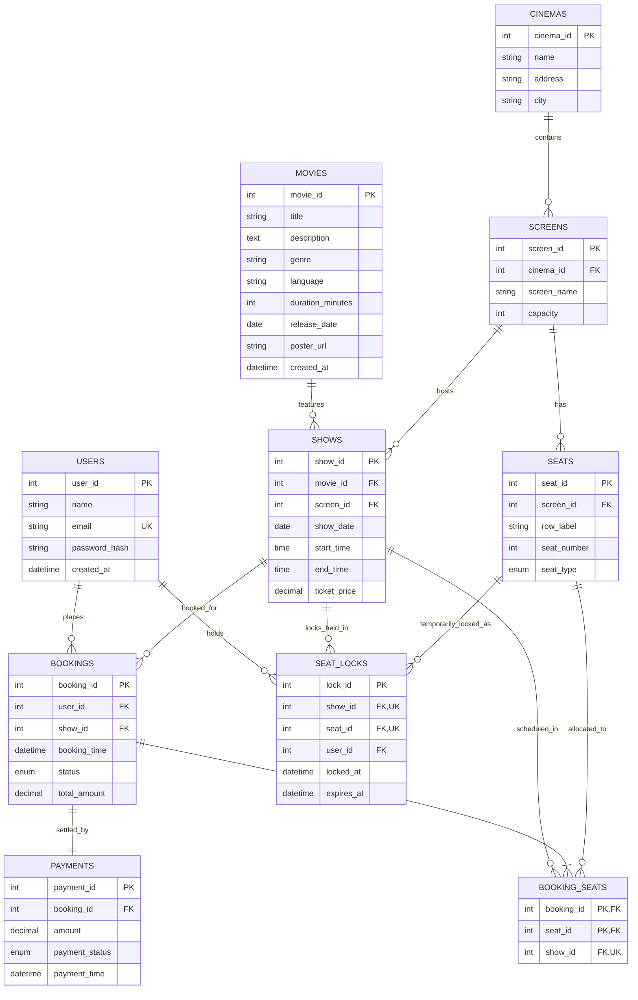

# CineBook — Entity Relationship (ER) Diagram

This document presents the Entity-Relationship (ER) model for the **CineBook** Movie Ticket Booking System.

---

## 1. Mermaid ER Diagram

---

## 2. Entity Descriptions & Cardinalities

### 1. `USERS` to `BOOKINGS` (1 : N)
- **One User** can make **zero or many Bookings** over time.
- **Each Booking** must belong to **exactly one User**.
- Cardinality: `1 : N` (One-to-Many).

### 2. `CINEMAS` to `SCREENS` (1 : N)
- **One Cinema** multiplex contains **one or many Screens** (Auditoriums).
- **Each Screen** belongs strictly to **one Cinema**.
- Cardinality: `1 : N`.

### 3. `SCREENS` to `SEATS` (1 : N)
- **One Screen** contains **multiple physical Seats** (e.g., Rows A–E, Seats 1–8).
- **Each Seat** physically belongs to **one Screen**.
- Cardinality: `1 : N`.
- Uniqueness constraint: `UNIQUE (screen_id, row_label, seat_number)`.

### 4. `MOVIES` to `SHOWS` (1 : N)
- **One Movie** can be scheduled for **zero or many Shows** across various dates, screens, and multiplexes.
- **Each Show** features **exactly one Movie**.
- Cardinality: `1 : N`.

### 5. `SCREENS` to `SHOWS` (1 : N)
- **One Screen** can host **many Shows** over different time slots.
- **Each Show** takes place in **exactly one Screen**.
- Cardinality: `1 : N`.
- Uniqueness constraint: `UNIQUE (screen_id, show_date, start_time)`.

### 6. `SHOWS` to `BOOKINGS` (1 : N)
- **One Show** can receive **many Bookings** from different patrons until auditorium capacity is reached.
- **Each Booking** is made for **one specific Show**.
- Cardinality: `1 : N`.

### 7. `BOOKINGS` to `BOOKING_SEATS` (1 : N)
- **One Booking** can include **one or more Seats** (e.g., booking tickets for a family).
- `BOOKING_SEATS` resolves the many-to-many relationship between `BOOKINGS` and `SEATS`.
- Cardinality: `1 : N`.

### 8. `SEATS` to `BOOKING_SEATS` (1 : N)
- A physical **Seat** can appear across multiple bookings over history, but for a specific show it is strictly unique:
- **Critical DBMS Invariant:** `UNIQUE (show_id, seat_id)` guarantees that no physical seat can be confirmed in more than one booking for the same show.

### 9. `BOOKINGS` to `PAYMENTS` (1 : 1)
- **Each Booking** produces **one simulated Payment record**.
- Cardinality: `1 : 1` (One-to-One).

### 10. `SHOWS` and `SEATS` to `SEAT_LOCKS` (1 : N)
- To prevent race conditions while a customer completes their checkout, a seat is temporarily held in `SEAT_LOCKS`.
- Constraint: `UNIQUE (show_id, seat_id)` prevents two concurrent users from holding a lock on the same seat for the same show.
- Each lock has an expiration timestamp (`expires_at`, 5-minute TTL).
